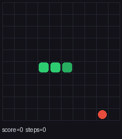
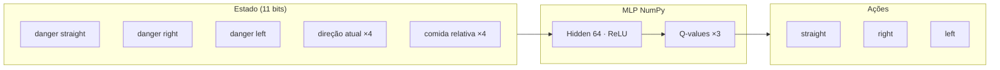
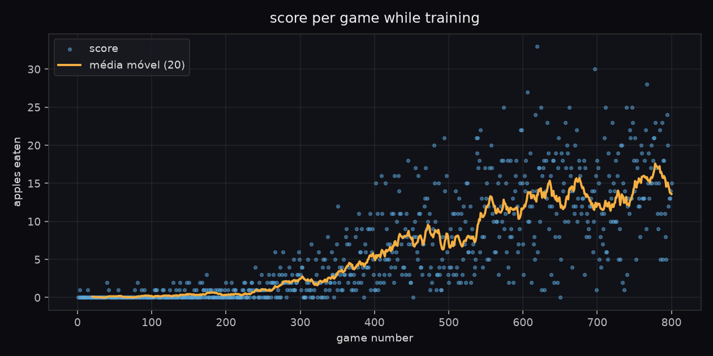

# Snake RL

**Eric Guerrize** — portfólio de engenharia de dados + reinforcement learning.

Uma rede neural escrita **só com NumPy** (sem PyTorch/TensorFlow) que aprende a jogar Snake com **Q-learning**. Cada episódio de treino vira dado de verdade: Parquet particionado, DuckDB e um dashboard Streamlit para analisar a curva de aprendizado.



---

## O que é isto (em poucas palavras)

Imagine ensinar uma cobra digital a comer maçãs sem bater na parede nem em si mesma. Em vez de programar regras (“se a comida está à direita, vire…”), a gente deixa um agente **tentar**, **errar** e **aprender** com recompensas:

- comeu maçã → **+10**
- bateu / timeout → **−10**

O “cérebro” é uma rede pequena: **11 números** descrevem o estado do jogo, uma camada escondida com **64 neurônios (ReLU)** calcula, e a saída são **3 valores Q** — um para cada ação relativa: seguir reto, virar à direita ou virar à esquerda.

---

## Arquitetura



| Camada | Tamanho | Ativação |
|--------|---------|----------|
| Entrada | 11 | — |
| Oculta | 64 | ReLU |
| Saída | 3 (Q) | linear |

---

## A matemática

### Atualização Q-learning

O alvo TD (temporal difference) para o par estado-ação \((s, a)\) é:

$$
y = r + \gamma \max_{a'} Q(s', a')
$$

(se o episódio terminou, \(y = r\)). Em seguida aproximamos \(Q_\theta(s, a) \approx y\) com descida de gradiente.

Política **ε-greedy**: com probabilidade \(1-\varepsilon\) escolhemos \(\arg\max_a Q(s,a)\); com probabilidade \(\varepsilon\) exploramos uma ação aleatória. O \(\varepsilon\) decai a cada episódio.

### Forward (NumPy)

$$
h = \max(0,\ x W_1 + b_1),\qquad q = h W_2 + b_2
$$

### Loss e backprop

Loss MSE sobre o Q da ação tomada:

$$
\mathcal{L} = \big(Q(s,a) - y\big)^2,\qquad
\frac{\partial\mathcal{L}}{\partial Q} = 2\big(Q(s,a) - y\big)
$$

Gradientes (como no código):

```text
dw2 = h.T @ dq
dh  = (dq @ W2.T) * (h > 0)   # ReLU
dw1 = x.T @ dh
```

Há um teste de **checagem numérica** (`tests/test_gradients.py`) que compara esses gradientes analíticos com diferenças finitas.

---

## Pipeline de dados (ângulo de data engineering)

Cada episódio grava: `episode`, `score`, `steps`, `total_reward`, `epsilon`, `loss`, `run_id`, `timestamp`.

```text
data/
  parquet/
    episodes/run_id=<id>/part-0.parquet
    runs/run_id=<id>/part-0.parquet
  duckdb/
    snake_rl.duckdb
```

O DuckDB espelha as partições Hive e alimenta:

- `snake report` — média móvel, melhor jogo, curva por terço do treino
- `snake dashboard` — Streamlit (learning curve, histograma, comparação entre runs)

---

## Como rodar

Requisitos: **Python 3.11+**.

```bash
pip install -e ".[dev,dashboard]"

# Treinar (gera pesos + Parquet + DuckDB + opcionalmente o PNG)
snake train --episodes 800 --seed 42 --curve docs/learning_curve.png

# Jogar no terminal (ASCII)
snake play --weights models/snake_dqn.npz --render

# Exportar GIF do agente guloso
snake gif --weights models/snake_dqn.npz --out docs/snake_play.gif

# Relatório SQL
snake report

# Dashboard
snake dashboard
```

Atalhos: `make install-dev`, `make test`, `make lint`, `make train`, `make gif`.

---

## Resultados reais (este repositório)

Treino executado neste ambiente:

| Item | Valor |
|------|-------|
| Comando | `snake train --episodes 800 --seed 42` |
| Grade | 10×10 |
| Rede | 11 → 64 ReLU → 3 |
| LR / γ / ε-decay | 0.002 / 0.9 / 0.995 |
| Melhor jogo no treino | **33** maçãs (episódio 619) |
| Score médio (800 eps, com exploração) | **6.40** |
| Média dos últimos 25 eps | **~14.8** |
| Avaliação gulosa (40 jogos) | média **18.2**, máx **34**, mín **8** |
| GIF (`docs/snake_play.gif`) | seed 13, score **34** |



O início é barulhento (ε alto → movimentos quase aleatórios). Por volta dos episódios 300–500 a média móvel sobe; no terço final do treino a média de score fica em torno de **13**.

Pesos commitados: [`models/snake_dqn.npz`](models/snake_dqn.npz).

---

## Estrutura do pacote

```text
snake_rl/
  env.py          # Snake headless, determinístico com seed
  features.py     # Vetor de 11 features booleanas
  agent.py        # MLP + Q-learning (forward/backprop manuais)
  replay.py       # Experience replay
  train.py        # Loop de treino
  logging_de.py   # Parquet particionado + DuckDB
  analysis.py     # Consultas SQL
  render.py       # ASCII, GIF, PNG da curva
  cli.py          # Typer: train | play | gif | report | dashboard
  dashboard.py    # Streamlit
tests/            # env, features, gradiente numérico, smoke train
```

---

## Testes e CI

```bash
make test    # pytest
make lint    # ruff
make ci      # lint + test
```

GitHub Actions (`.github/workflows/ci.yml`) roda ruff + pytest em Python 3.11 e 3.12.

---

## Licença

MIT © Eric Guerrize — ver [LICENSE](LICENSE).
